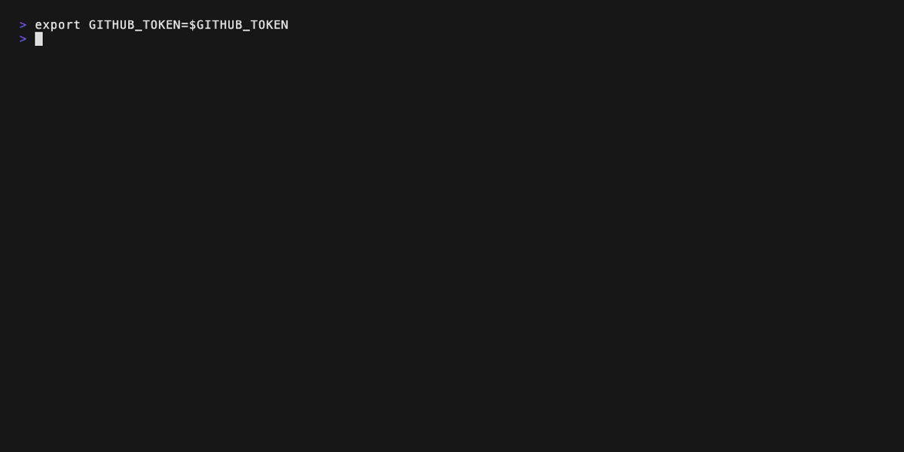

# github-code-search


[](https://fulll.github.io/github-code-search/)
[](https://github.com/fulll/github-code-search/releases/latest)

Interactive CLI to search GitHub code across an organization — per-repository aggregation,
keyboard- and mouse-driven TUI, fine-grained extract selection, markdown/JSON output.

→ **Full documentation: https://fulll.github.io/github-code-search/**



## Requirements

- **Bun** ≥ 1.4.4 when running or building from source; compiled binaries do not require Bun
- **GitHub Token** with `repo` and `read:org` scopes

Development uses Bun's built-in `bun fmt` and `bun check`, with no standalone
formatter or linter dependency. Run `bun run format`, `bun run format:check` and
`bun run typecheck`; `bun run lint` is a compatibility alias for type checking,
not equivalent lint coverage. See [Contributing](CONTRIBUTING.md) for setup and checks.

## Quick start

**macOS / Linux**

```bash
export GITHUB_TOKEN=ghp_xxxxxxxxxxxxxxxxxxxx
curl -fsSL https://raw.githubusercontent.com/fulll/github-code-search/main/install.sh | bash
github-code-search query "TODO" --org my-org
```

**Windows** (PowerShell)

```powershell
$env:GITHUB_TOKEN = "ghp_xxxxxxxxxxxxxxxxxxxx"
powershell -c "irm https://raw.githubusercontent.com/fulll/github-code-search/main/install.ps1 | iex"
github-code-search query "TODO" --org my-org
```

> [!TIP]
> `GITHUB_TOKEN` falls back to `gh auth token` when unset and the [GitHub CLI](https://cli.github.com/) is installed and authenticated.
> Set `GCS_DEFAULT_ORG=my-org` to omit `--org` on every call. See [Environment variables](https://fulll.github.io/github-code-search/reference/environment).

## Features

- **Org-wide search** — queries all repositories in a GitHub organization in one command, with automatic pagination up to 1 000 results
- **Per-repository aggregation** — results grouped by repo, not as a flat list; fold/unfold each repo to focus on what matters
- **Keyboard- and mouse-driven TUI** — navigate with arrow keys or mouse clicks, toggle selections, scroll with the wheel, filter by file path, confirm with Enter — without leaving the terminal
- **Fine-grained selection** — pick exactly the repos and extracts you want; deselected items are recorded as exclusions in the replay command
- **Structured output** — Markdown document with a `# Results for` query heading, GitHub deeplinks and the exact matched token per extract; or machine-readable JSON that, when segment data is available, includes `matchedText`, `line` and `col` fields — ready to paste into docs, issues or scripts
- **Team-prefix grouping** — group results by team prefix (e.g. `platform/`, `data/`) using `--group-by-team-prefix`
- **Replay command** — every session produces a one-liner you can run in CI to reproduce the exact same selection without the UI
- **Regex search** — use `/pattern/flags` syntax for pattern-based searches; the CLI derives a safe API query and filters results locally
- **Syntax highlighting** — code fragments rendered with language-aware coloring (TypeScript, Python, Go, Rust, YAML, JSON and more)

## Use cases

**Audit a dependency across the org**

```bash
github-code-search query "from 'lodash'" --org my-org
```

Instantly see every repo still importing lodash, select the ones to migrate, and get a Markdown checklist to paste in your migration issue.

**Hunt down TODOs before a release**

```bash
github-code-search query "TODO" --org my-org --exclude-repositories sandbox,archived-repo
```

Surfaces all in-code TODOs, lets you triage interactively, and outputs a linked list for your release notes.

**Verify a breaking-change rollout**

```bash
github-code-search query "oldApiClient" --org my-org --output-type repo-only --format json
```

Use JSON output in a CI script to assert that no repository still references the deprecated client after your migration deadline.

**Security sweep — find hardcoded secret patterns**

```bash
github-code-search query "process.env.SECRET" --org my-org
```

Cross-repo scan for risky patterns; export results to Markdown to attach to a security audit report.

**Onboarding — understand how an internal library is used**

```bash
github-code-search query "useFeatureFlag" --org my-org --group-by-team-prefix platform/
```

Get a team-scoped view of every usage site before refactoring a shared hook or utility.

**Skip template repositories**

```bash
github-code-search query "TODO" --org my-org --exclude-template-repositories
```

Exclude repositories that are marked as GitHub templates, so boilerplate repos don't clutter your results.

**Regex search — pattern-based code audit**

```bash
github-code-search query "/from.*['\"\`]axios/" --org my-org
```

Use `/pattern/` syntax to run a regex search. The CLI automatically derives a safe API query term and filters results locally — no manual post-processing needed. Use `--regex-hint` to override the derived term when auto-extraction is too broad.

## Why not `gh search code`?

The official [`gh` CLI](https://cli.github.com/) does support `gh search code`, but it returns a **flat paginated list** — one result per line, no grouping, no interactive selection, no structured output.

|                                                           | `gh search code` | `github-code-search` |
| --------------------------------------------------------- | :--------------: | :------------------: |
| Results grouped by repo                                   |        ✗         |          ✓           |
| Interactive TUI (navigate, select, filter, mouse support) |        ✗         |          ✓           |
| Fine-grained extract selection                            |        ✗         |          ✓           |
| Markdown / JSON output                                    |        ✗         |          ✓           |
| Replay / CI command                                       |        ✗         |          ✓           |
| Team-prefix grouping                                      |        ✗         |          ✓           |
| Regex search                                              |        ✗         |          ✓           |
| Syntax highlighting in terminal                           |        ✗         |          ✓           |
| Pagination (up to 1 000 results)                          |        ✓         |          ✓           |

`github-code-search` is purpose-built for **org-wide code audits and interactive triage** — not just a search wrapper.

## Contributing and documentation quality

See [CONTRIBUTING.md](CONTRIBUTING.md) for development setup and checks.
Documentation accessibility uses the maintained Deque `@axe-core/playwright` adapter,
reusing Playwright rather than installing a second browser automation stack:

```bash
bun run docs:build:a11y
bun run docs:preview -- --port 4173
# In another terminal, with Playwright Chromium installed:
bun run docs:a11y
```

The audit checks every sitemap URL with WCAG 2.0/2.1/2.2 A/AA tags and writes JSON
and Markdown reports. CI reuses system Chrome without downloading a browser.
Automated checks do not certify WCAG compliance: incomplete results, keyboard use,
screen-reader behavior and interactive states still need manual review.
See the [audit guide and alternatives benchmark](https://fulll.github.io/github-code-search/reference/accessibility).
